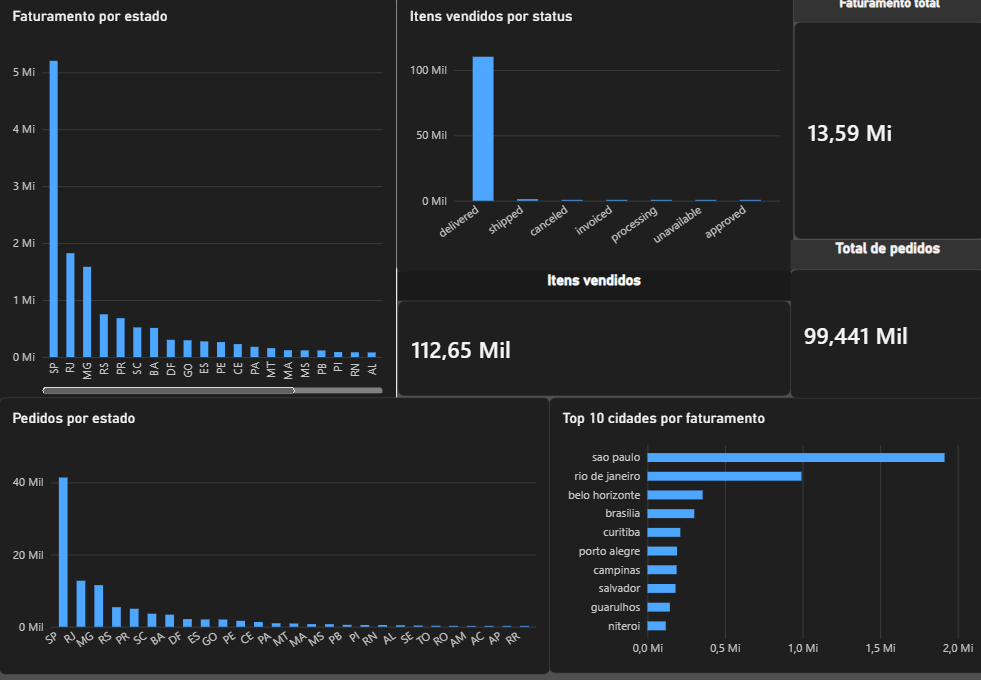

# Análise de Vendas Olist

Análise de vendas de um e-commerce brasileiro usando **SQL**, **Excel** e **Power BI**. O projeto parte de perguntas de negócio, responde cada uma com consultas SQL, valida os resultados em gráficos no Excel e reúne tudo em um dashboard no Power BI.

## Perguntas respondidas

| # | Pergunta | Onde está |
|---|---|---|
| 1 | Quais os 5 estados com mais pedidos? | SQL + Excel (`desafio 1.xlsx`) |
| 2 | Quais os 5 estados com mais pedidos entregues? | SQL |
| 3 | Quantos itens foram vendidos em cada status de pedido? | SQL + Excel (`desafio 3.xlsx`) |
| 4 | Quais os 5 estados com maior faturamento? | SQL |
| 5 | Quais os 5 estados com maior preço médio por item? | SQL |
| 6 | Quais as 10 cidades com maior faturamento? | SQL + Excel (`desafio 6.xlsx`) |
| 7 | Quais estados têm maior preço médio por item, considerando só os que venderam pelo menos 500 itens? | SQL |
| 8 | Quais estados têm faturamento acima de 500 mil em pedidos entregues? | SQL + Excel (`desafio 8.xlsx`) |

## O que os dados mostram

- **São Paulo** lidera em tudo: cerca de **41,7 mil pedidos** e mais de **R$ 5 milhões** de faturamento em pedidos entregues, quase 3 vezes o do Rio de Janeiro.
- Os três estados com maior faturamento em pedidos entregues são **SP, RJ e MG**.
- A cidade de **São Paulo** fatura quase o dobro da segunda colocada (Rio de Janeiro).
- Cerca de **98% dos itens vendidos** pertencem a pedidos entregues. Cancelamentos e itens indisponíveis são raros.

No dashboard, o faturamento total é de aproximadamente **R$ 13,6 milhões**, com cerca de **99,4 mil pedidos** e **112,6 mil itens** vendidos.

> Os gráficos do Excel (desafio 8) filtram só pedidos entregues. O dashboard considera todos os status, por isso os valores por estado podem diferir um pouco.

## Ferramentas

- **SQL (MySQL):** consultas com `JOIN`, `GROUP BY`, `HAVING` e funções de agregação
- **Excel:** conferência dos resultados e gráficos
- **Power BI:** modelo com 3 tabelas relacionadas e dashboard com 6 visuais

## Arquivos

| Arquivo | Descrição |
|---|---|
| `consultas_olist.sql.sql` | As 8 consultas SQL, comentadas |
| `desafio 1.xlsx`, `desafio 3.xlsx`, `desafio 6.xlsx`, `desafio 8.xlsx` | Resultados e gráficos no Excel |
| `painel_olist.pbix.pbix` | Dashboard no Power BI |
| `dashboard.png.png` | Imagem do dashboard |

## Dados

Os dados vêm do dataset público **Brazilian E-Commerce Public Dataset by Olist**, disponível no Kaggle: https://www.kaggle.com/datasets/olistbr/brazilian-ecommerce

Os arquivos originais não estão neste repositório por causa do tamanho. Para reproduzir a análise, baixe o dataset e use as tabelas `customers`, `orders` e `order_items`.

## Como abrir o dashboard

1. Instale o **Power BI Desktop**.
2. Abra o arquivo `painel_olist.pbix.pbix`.
3. Se pedir, aponte as fontes para os CSVs do dataset baixado.

**Atenção ao separador decimal:** na tabela de itens, a coluna `price` usa ponto como decimal. Ao importar, converta o tipo com *Alterar Tipo → Usando Localidade → Inglês (Estados Unidos)*. Sem isso, o Power BI lê `58.90` como `5890`.

## Autor

**Luis** · [GitHub](https://github.com/Luizgarcg)
